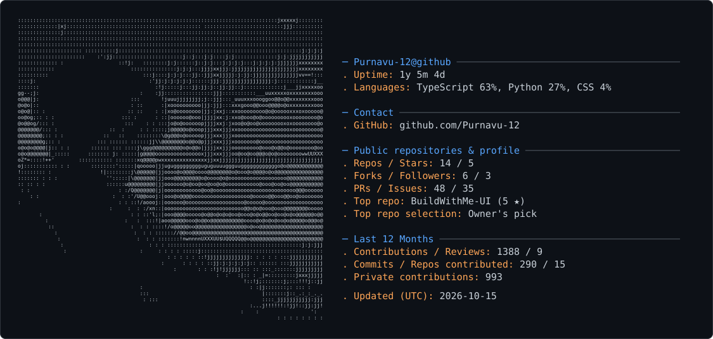

  <a href="https://purnasai-portfolio-two.vercel.app/"><strong>Portfolio ↗</strong></a>

<picture>
  <source media="(prefers-color-scheme: dark)" srcset="dark_mode.svg" />
  <source media="(prefers-color-scheme: light)" srcset="light_mode.svg" />
  
</picture>

Building & Shipping System > Just understanding concepts

I'm an undergrad obsessed with the mechanics of production-grade software. Anyone can write a script, but I want to know how a system behaves when the state is distributed, the network is unreliable, and the users are real.

**Stacking knowledge in:**

Distributed Systems | Agentic AI & MCP | Cloud & Containers | CI/CD Pipelines | Applied DSA | Product Engineering

If it has complex failure modes and needs to scale, I want to build it.

**Languages** · C • C++ • Java • Python • TypeScript • JavaScript • SQL

**Frameworks** · Next.js • FastAPI • React • Vue • Svelte • Shadcn/ui • Tailwind CSS • Prisma • Framer

**AI & Integrations** · RAG • LangGraph • Whisper STT • TTS • Google OAuth • Payments • Supabase • Swagger • Amazon Bedrock

**Cloud & Delivery** · AWS (EC2, S3, IAM) • Google Cloud • Docker • Vercel • GitHub Actions • Kafka

**Tools & Data** · Git • GitHub • Linux • PostgreSQL • ChromaDB • Redis • Amazon Aurora • Postman • Figma

**Foundations** · DSA • OOP • DBMS • High-Level Design • Hashing • Database sharding • Microservices • Message queues

**More technologies** · HTML • CSS • PL/pgSQL • Dockerfiles • MCP

**[SwiftBuild](https://github.com/SwiftBuild-ai)** &nbsp;·&nbsp; <samp>organization · admin & contributor</samp> 
Admin and contributor at SwiftBuild, building and maintaining projects with the organization.

**[BuildWithMe-UI](https://github.com/Purnavu-12/BuildWithMe-UI)** &nbsp;·&nbsp; <samp>react, vue, svelte, typescript</samp> 
Creator and primary maintainer of an open-source component library. Discover, copy, and remix polished UI components to build modern interfaces faster.

**[StateMe](https://github.com/Purnavu-12/StateMe)** &nbsp;·&nbsp; <samp>next.js, typescript, amazon aurora, postgresql</samp> 
A multi-tenant status page and incident management SaaS. Teams publish public status pages, manage incidents, send subscriber notifications, and generate AI postmortems — all in one place.

**[Life-log](https://github.com/Purnavu-12/Life-log)** &nbsp;·&nbsp; <samp>fastapi, next.js, whisper, chromadb</samp> 
Transform fleeting thoughts into structured, searchable memories. Captures audio, transcribes, extracts insights, integrates with calendar and email.

&nbsp;
&nbsp;

